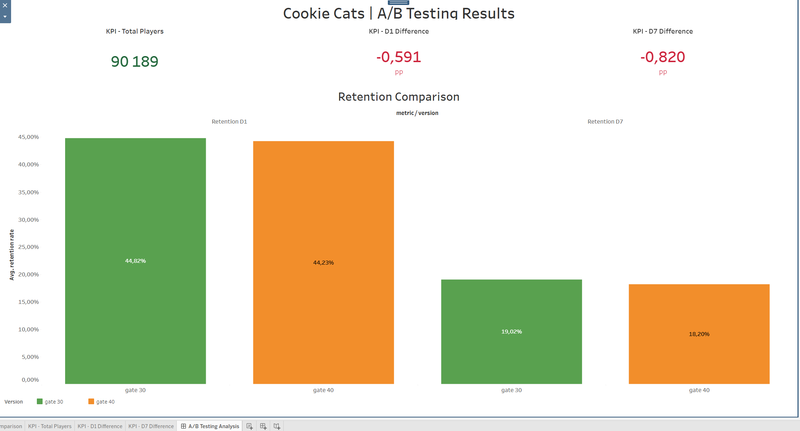
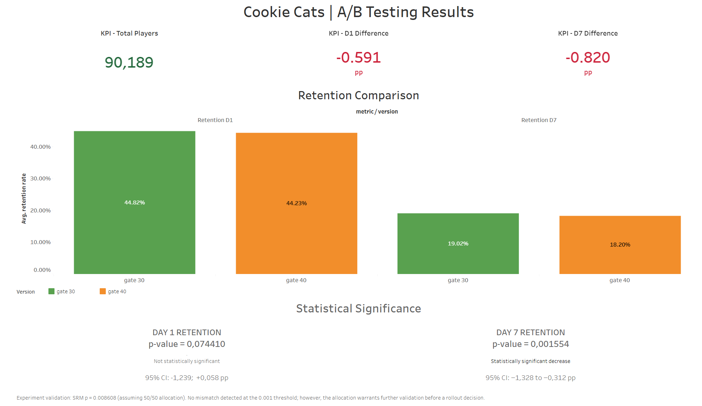

# A/B Testing Analysis — Cookie Cats

## Project Overview

This project analyzes the results of an A/B experiment conducted in the mobile game Cookie Cats.

The experiment tested whether moving the first progression gate from level 30 to level 40 would affect player retention and engagement.

The analysis uses SQL (Google BigQuery) and Python to evaluate retention rates and determine whether observed differences are statistically significant.

## Business Problem

The company wants to understand whether changing the gate placement improves player engagement and retention.

Two experimental groups were compared:

- **Control (gate_30):** The first gate appears at level 30.
- **Treatment (gate_40):** The first gate appears at level 40.

The main objective is to determine which version performs better in terms of Day 1 and Day 7 retention.

## Dataset

**Source:** [Cookie Cats A/B Testing — Kaggle](https://www.kaggle.com/datasets/yufengsui/mobile-games-ab-testing)

**Total Users:** 90,189

**Dataset Columns:**
- `userid` — Unique player identifier
- `version` — Experiment group
- `sum_gamerounds` — Number of game rounds played
- `retention_1` — Day 1 retention indicator
- `retention_7` — Day 7 retention indicator

## Tools & Technologies

- Google BigQuery — SQL analysis and data validation
- Python — Statistical analysis
- Pandas and NumPy — Data analysis libraries
- Statsmodels — Two-proportion Z-tests
- Google Colab — Python development environment
- Tableau Public — Retention analysis and dashboard development

## Data Quality Checks

The dataset contains 90,189 records representing 90,189 unique users.

The following checks were completed:

- Missing values: 0
- Duplicate User IDs: 0
- Invalid experiment groups: 0
- Negative game rounds: 0

No issues were detected in the completed validation checks.

## Retention Analysis

| Metric | Control (gate_30) | Treatment (gate_40) |
|---|---:|---:|
| Total Users | 44,700 | 45,489 |
| Day 1 Retention | 44.82% | 44.23% |
| Day 7 Retention | 19.02% | 18.20% |
| Average Game Rounds | 52.46 | 51.30 |

## Statistical Analysis

A two-sided two-proportion Z-test was performed to compare retention rates between the control and treatment groups.

**Significance Level:** α = 0.05

| Metric | Z-statistic | P-value | Result |
|---|---:|---:|---|
| Day 1 Retention | 1.7841 | 0.074410 | Not Significant |
| Day 7 Retention | 3.1644 | 0.001554 | Significant |

## Initial Findings

**Day 1 Retention:**

The treatment group showed a decrease of approximately 0.59 percentage points compared with the control group.

However, the difference was not statistically significant at the 5% significance level.

**Day 7 Retention:**

The treatment group showed a decrease of approximately 0.82 percentage points.

The difference was statistically significant (p = 0.001554), suggesting that moving the gate to level 40 negatively affected Day 7 retention.

### Sample Ratio Mismatch (SRM) Validation

A Chi-square goodness-of-fit test was conducted to evaluate whether the observed experiment allocation differed from the assumed 50/50 split.

**Results:**
- Control group: 44,700 users
- Treatment group: 45,489 users
- Chi-square statistic: 6.9024
- P-value: 0.008608
- SRM significance threshold: 0.001

**Interpretation:**

No statistically significant sample ratio mismatch was detected at the predefined threshold of 0.001.

However, the p-value is below 0.05, indicating some evidence of an allocation imbalance under the assumed 50/50 design.

Further validation of the experiment assignment mechanism would be recommended before making a final rollout decision.

### Tableau Retention Analysis — Initial Visualization

**Completed:**
- Created `tableau_retention_metrics` in Google BigQuery.
- Prepared retention data for Tableau visualization.
- Exported the aggregated dataset to CSV.
- Connected the dataset to Tableau Public.
- Created the first worksheet: Retention Comparison.
- Configured percentage formatting and experiment group colors.
- Validated the results against SQL calculations.

**Key Findings:**
- Control D1 Retention: 44.82%
- Treatment D1 Retention: 44.23%
- Control D7 Retention: 19.02%
- Treatment D7 Retention: 18.20%

**Next Steps:**
- Create KPI cards.
- Visualize statistical significance and confidence intervals.
- Build the final A/B Testing Dashboard.
- Add business insights and recommendations.

## Preliminary Business Recommendation

The results suggest that retaining the gate at level 30 is preferable for Day 7 player retention.

Moving the gate to level 40 resulted in a statistically significant decrease in Day 7 retention of approximately 0.82 percentage points (p = 0.001554).

The 95% confidence interval for the difference was [-1.328, -0.312] percentage points.

However, the experiment allocation showed some evidence of imbalance under the assumed 50/50 design (SRM p = 0.008608).

Therefore, the recommendation is provisional until the experiment design and allocation mechanism have been further validated.

### Tableau Dashboard — KPI Cards and Retention Comparison

An interactive A/B testing dashboard is being developed in Tableau Public to communicate experiment performance and support product decisions.

**Completed:**
- Created a KPI card displaying the total number of experiment participants.
- Developed calculated fields for Day 1 and Day 7 retention differences.
- Calculated retention differences as Treatment minus Control.
- Displayed differences in percentage points (pp).
- Integrated three KPI cards and the Retention Comparison chart into one dashboard.
- Improved typography, alignment, chart labels, and color formatting.
- Validated KPI values against SQL and Python results.

**Dashboard KPIs:**

| KPI | Value |
|---|---:|
| Total Players | 90,189 |
| D1 Retention Difference | -0.591 pp |
| D7 Retention Difference | -0.820 pp |

**Interpretation:**

The treatment group (gate_40) demonstrated lower retention rates than the control group (gate_30) on both Day 1 and Day 7.

The Day 1 difference was not statistically significant (p = 0.074410), whereas the Day 7 decrease was statistically significant (p = 0.001554).

The dashboard will be extended with confidence intervals and an experiment validation note before final publication.

**Dashboard Preview:**

### Tableau Dashboard — Statistical Significance

Extended the A/B testing dashboard with statistical significance results and confidence intervals.

**Completed:**
- Added Day 1 and Day 7 statistical significance indicators.
- Displayed p-values from two-proportion Z-tests.
- Included 95% confidence intervals calculated using the Newcombe method.
- Added an experiment validation note covering Sample Ratio Mismatch (SRM).

**Key Findings:**
- D1 Retention: p = 0.074410 — not statistically significant.
- D7 Retention: p = 0.001554 — statistically significant decrease.
- D7 95% CI: [-1.328, -0.312] percentage points.
- Experiment allocation requires further validation before a final rollout decision.

**Updated Dashboard Preview:**

## Next Steps

- [x] Prepare and validate the dataset using SQL.
- [x] Calculate Day 1 and Day 7 retention rates.
- [x] Perform statistical significance testing using Python.
- [x] Calculate 95% confidence intervals.
- [x] Perform Sample Ratio Mismatch (SRM) validation.
- [x] Create the Retention Comparison visualization.
- [x] Develop the three main Tableau KPI cards.
- [x] Add statistical significance indicators to Tableau.
- [ ] Visualize 95% confidence intervals.
- [ ] Include experiment validation limitations and business recommendations.
- [ ] Publish the final Tableau Dashboard.
- [ ] Complete the final GitHub documentation and portfolio review.
